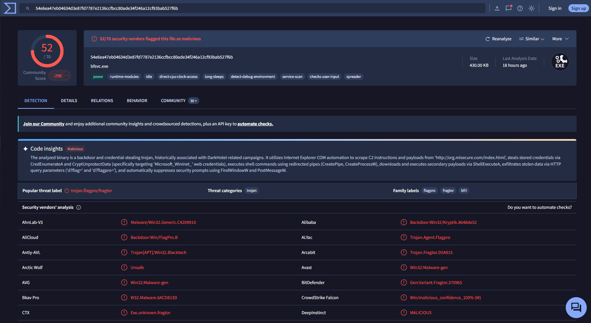
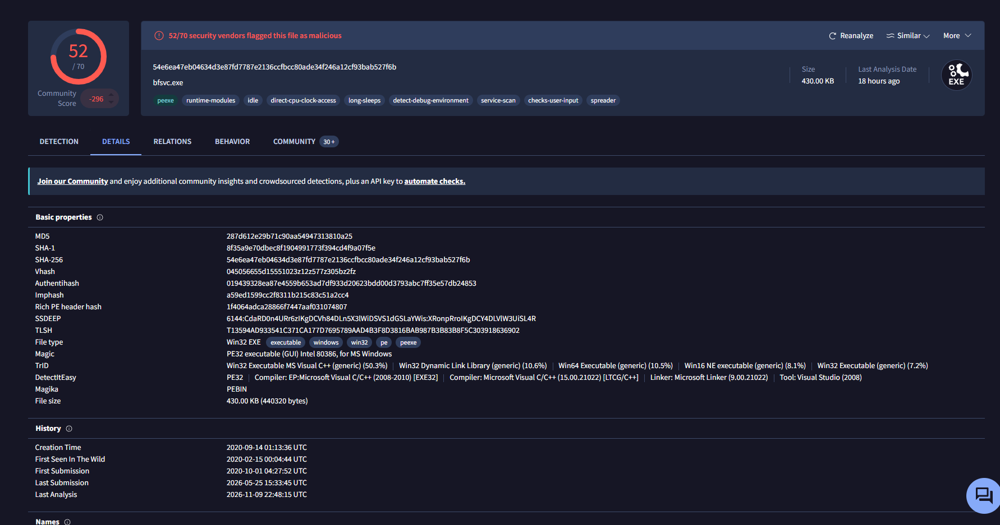
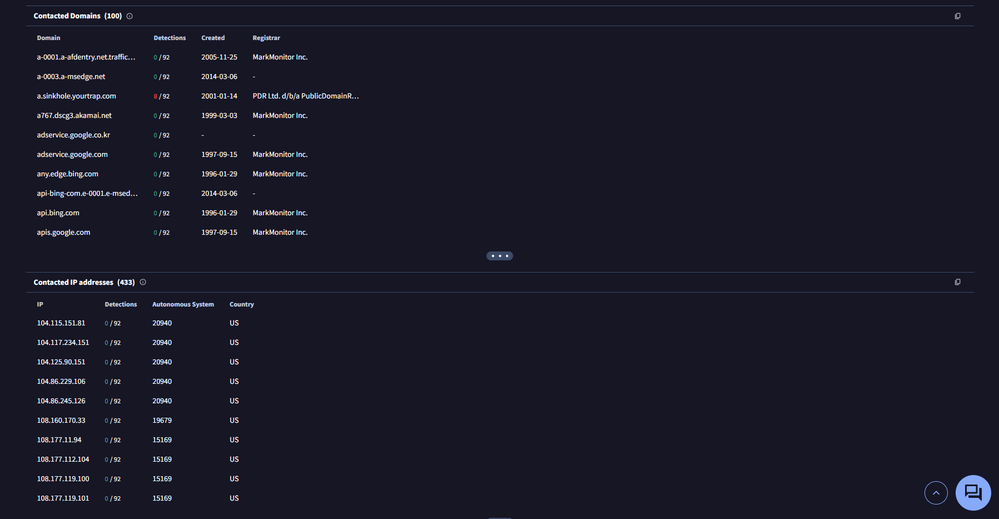
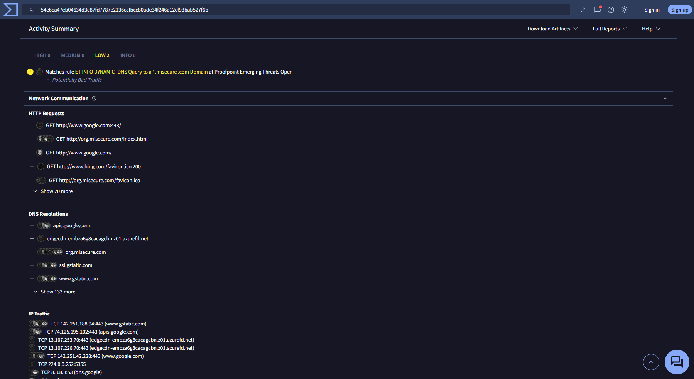
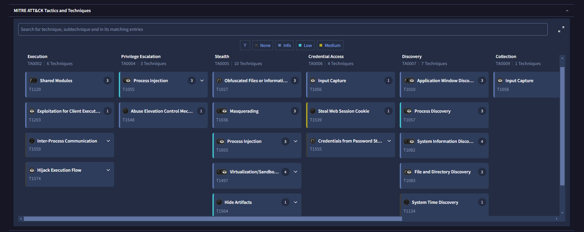
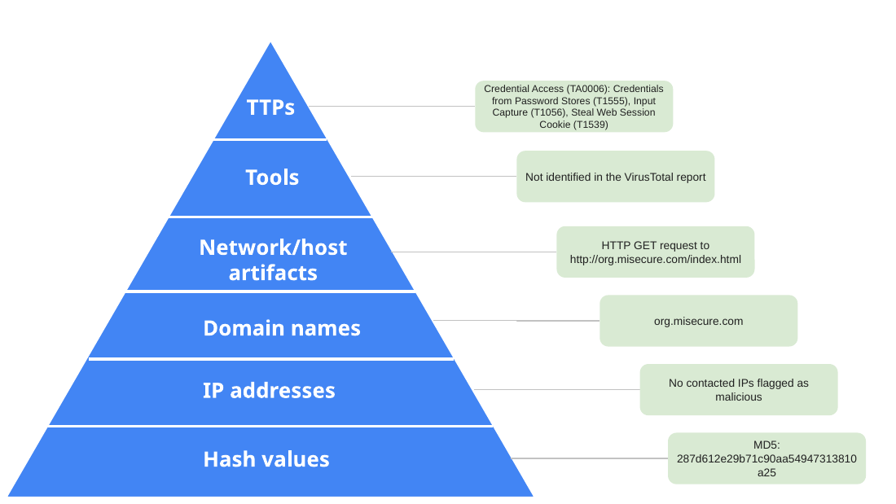

# VirusTotal Analysis and the Pyramid of Pain

## Summary
A course activity where I investigated a malicious file hash in VirusTotal, decided whether the file was malicious, and mapped the indicators of compromise (IoCs) I found onto the Pyramid of Pain.

## My Role
I ran the hash lookup in VirusTotal, reviewed the Detection, Details, Relations, and Behavior tabs, picked the indicators, and filled in the Pyramid of Pain template. The screenshots in this repo are from my own lookup. The hash and scenario were provided by the course.

## Project Overview

This project documents the VirusTotal and Pyramid of Pain activity from the Google Cybersecurity Certificate (Sound the Alarm: Detection and Response). The goal was to use shared threat intelligence to confirm a suspicious file and pull out related IoCs that a SOC team could use for detection and blocking.

---

## Scenario

As a level one SOC analyst at a financial services company, I received an alert about a suspicious file downloaded on an employee's computer. The employee had received an email with a password-protected spreadsheet attachment, with the password in the email body. Opening the file executed a malicious payload.

| Time | Event |
|---|---|
| 1:11 p.m. | Employee receives an email with a file attachment |
| 1:13 p.m. | Employee downloads and opens the file |
| 1:15 p.m. | Multiple unauthorized executable files are created on the computer |
| 1:20 p.m. | An intrusion detection system detects the executables and alerts the SOC |

**SHA256 hash investigated:** `54e6ea47eb04634d3e87fd7787e2136ccfbcc80ade34f246a12cf93bab527f6b`

---

## Tools Used

- **VirusTotal** (threat intelligence and file reputation)
- **MITRE ATT&CK** (mapping tactics and techniques)

---

## Verdict: Is the File Malicious?

**Yes.** 52 of 70 security vendors flagged the hash, and the file (`bfsvc.exe`) has a community score of -296. Vendors consistently label it a trojan in the Flagpro/Fragtor family; for example, Alibaba detects it as `Backdoor:Win32/Kryptik`, BitDefender as `Gen:Variant.Fragtor`, and CrowdStrike Falcon reports it as malicious with 100% confidence. VirusTotal's code insights describe it as a backdoor and credential-stealing trojan that contacts `org.misecure.com` for instructions, downloads secondary payloads, and exfiltrates stolen data over HTTP. The high vendor ratio, negative community score, and consistent detections all point to the same conclusion.

---

## Pyramid of Pain

| Level | Indicator | Where I found it |
|---|---|---|
| TTPs | Credential Access (TA0006): Credentials from Password Stores (T1555), Input Capture (T1056), Steal Web Session Cookie (T1539) | Behavior tab, MITRE ATT&CK Tactics and Techniques |
| Tools | Not identified in the report | |
| Network/host artifacts | HTTP GET request to `http://org.misecure.com/index.html` | Behavior tab, Network Communication |
| Domain names | `org.misecure.com` | Behavior tab DNS resolutions; flagged by a Proofpoint Emerging Threats rule (`*.misecure.com` DNS query) |
| IP addresses | No contacted IPs flagged as malicious in the entries reviewed | Relations tab, Contacted IP addresses |
| Hash values | MD5 `287d612e29b71c90aa54947313810a25` (SHA-1 `8f35a9e70dbec8f1904991773f394cd4f9a07f5e`) | Details tab, Basic properties |

The completed template is in [`template/`](template) as PPTX and PDF.

---

## Screenshots

### 1. Detection tab: 52/70 vendors flagged the file

### 2. Details tab: MD5, SHA-1, and SHA-256 hashes

### 3. Relations tab: contacted domains and IP addresses

### 4. Behavior tab: network communication to org.misecure.com

### 5. Behavior tab: MITRE ATT&CK tactics and techniques

### 6. Completed Pyramid of Pain

---

## Skills Demonstrated

- Looking up a file hash in VirusTotal and interpreting the vendor ratio, community score, and detection names
- Finding related hashes, domains, IPs, and network activity across the report's tabs
- Telling malicious domains apart from benign ones (Google, Bing, Akamai) using the Detections column
- Mapping sandbox behavior to MITRE ATT&CK tactics and techniques
- Classifying IoCs by the Pyramid of Pain

---

## What I Learned

- Blocking a hash is easy for defenders but just as easy for attackers to get around, since changing the file changes the hash. Indicators higher on the pyramid, like TTPs, cost the attacker much more to change.
- Most contacted domains and IPs in a sandbox report are normal background traffic, so the Detections column matters before calling something an IoC.
- One tool is not enough. A low score doesn't prove a file is safe, so a verdict should rest on several signals that agree.
- Anything uploaded to VirusTotal becomes public, so searching by hash is safer than uploading a file that might contain sensitive data.

---

## Disclaimer

Course activity from the Google Cybersecurity Professional Certificate (Coursera). The file hash was provided by the course; I only looked it up in VirusTotal and did not download or run the malware. The write-up is my own.

## Certificate
Google Cybersecurity Certificate — Sound the Alarm: Detection and Response
